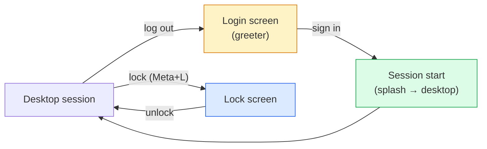
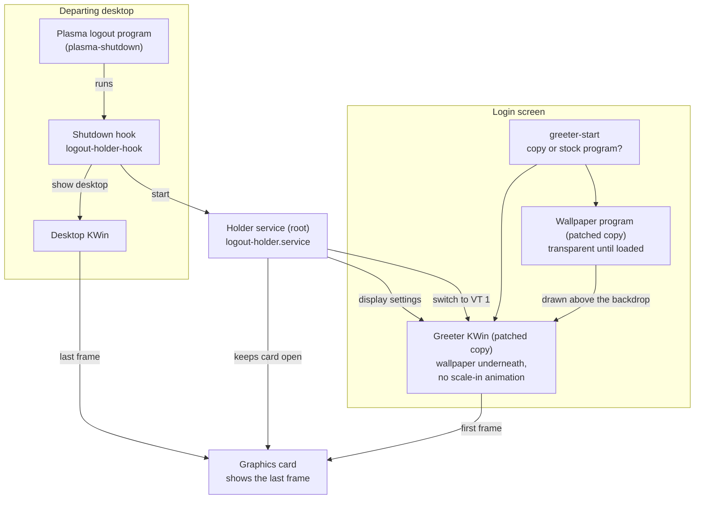
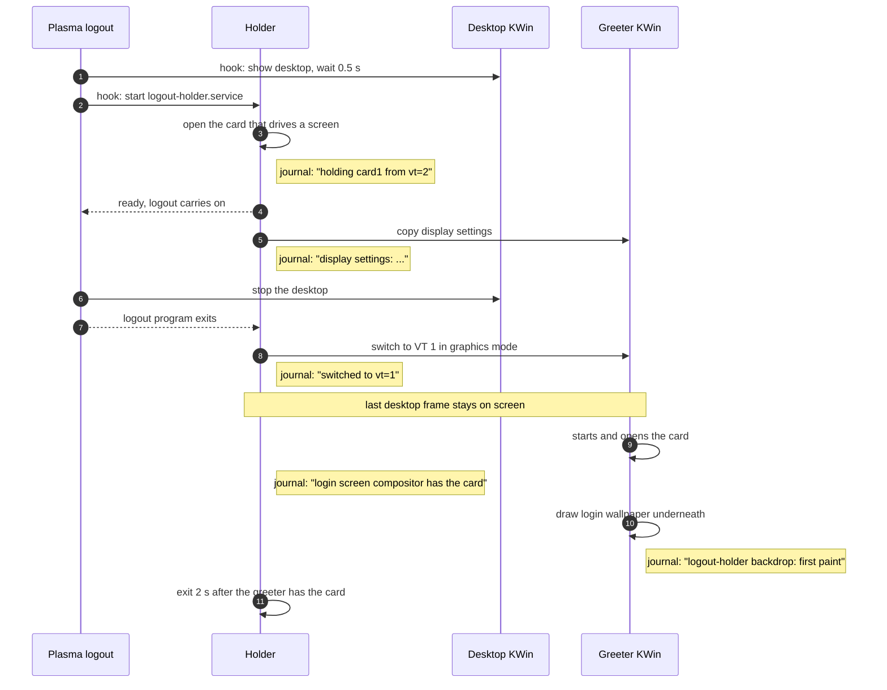

# Plasma logout handoff

At Log Out, the desktop's wallpaper and panel stay on screen until the login
screen appears over its own wallpaper. Without this project the screen goes
black between them. It covers Plasma 6.8.3 Wayland with Plasma Login Manager
on CachyOS.

The installed **logout holder** (v7, `/usr/local/lib/logout-holder`) keeps the
desktop's last frame on screen until the login screen's compositor takes the
graphics card.

## Where it fits

Four projects each own one handoff of the screen. The goal is that the
screen never shows black between them.



| Handoff | Project |
|---|---|
| Desktop ⇄ lock screen (blue) | plasma-lock-handoff |
| Sign-in → desktop (green) | plasma-login-handoff |
| Logout → login screen (amber) | **plasma-logout-handoff** (this repo) |
| Building, testing and installing the session patches (lock, login); rollback. The logout holder is only checked | plasma-handoff-maintenance |

## The pieces



- **The holder never controls the card.** It keeps it open, so the console
  does not return to text mode and wipe the picture.
- **The frame shows no open windows.** The hook asks KWin to show the desktop
  and waits 0.5 s.
- **The monitor does not re-sync.** The holder copies the desktop's
  `kwinoutputconfig.json` to the login screen.
- **No black first frame, no scale-in.** The greeter KWin draws the login
  wallpaper underneath, and gets `scaleEnabled=false` so the login screen does
  not dim and grow in over it.
- **Only a logout switches screens.** At restart or shutdown the display
  settings are copied, and the console is not switched.
- **Package updates fall back** to the stock programs: sign-in works, without
  the backdrop.
- A wrapper, `login-screen-start`, brings the login screen back after a failed
  sign-in.

## Timeline



`card1` and `vt=2` are the test PC's. KWin may stop before or after the switch.

## Status (2026-11-27)

Live results are from one CachyOS laptop: Intel graphics driving an HDMI
monitor at 4K 60 Hz, lid closed. "VM" means the QEMU guest only.

| What | State |
|---|---|
| Logout without black, v7 | **Works.** First live logout 17:01, user: smooth |
| Sign-in after logout | Works (v7) |
| Keyboard sign-in with the lid closed | Works (first checked with v2) |
| No scale-in on the login screen | Works live |
| Shutdown from the Plasma menu | Worked live with v5. **Not tried with v7**; passes in VM |
| Restart from the Plasma menu | Worked live with v4. **Not tried with v7**; passes in VM |
| Login screen after a failed sign-in | VM only. No failed sign-in live since v6 |
| Failed quick re-login (DrKonqi cancels the session stop) | Workaround drop-in installed; live logouts passed. The race (2 of 21 exits) is not proven gone |
| Black at sign-in (after the password) | Still there (reported with v6 and v7); belongs to the login project |
| Black at restart or shutdown | Unchanged from stock |
| NVIDIA output, DisplayPort, several monitors | Holder not tested |
| Stalled login screen, cancelled logout | Not tested (the 15 s give-up ran once, in the v3 restart failure) |
| Manjaro with SDDM (NVIDIA) | No fix. About 1.6 s of black remains |

Also installed on the test PC (checked 2026-11-27):

| Change | Purpose | Undo |
|---|---|---|
| `~/.config/systemd/user/drkonqi-coredump-launcher.socket.d/stop-with-graphical-session.conf` | re-login workaround | delete the file, `systemctl --user daemon-reload` |
| kernel parameter `video=DP-1:3840x2160@100` and `/etc/systemd/user-environment-generators/20-nvidia-rtd3-workaround` | earlier timing fixes for the DisplayPort setup | `sudo bash vandal-keep-handoff.sh --restore` |

`/etc/profile.d/nvidia-rtd3-workaround.sh` probably still adds about 2.3 s to
greeter startup when the NVIDIA GPU is asleep. Not fixed; the picture stays up.

## Check a live system

Log out, sign in again, then:

```bash
journalctl -b -o short-precise | grep logout-holder
journalctl -b -g 'starting the stock'
```

A good logout logs the `journal:` lines of the timeline above, in that order,
plus `logout; desktop compositor ...` before the switch. The second command finds nothing when both patched copies ran.

| Line | Meaning |
|---|---|
| `refused: ...` | the holder did nothing; the reason follows |
| `shutdown or restart: not switching` | normal at restart or shutdown; the service may also stop before logging it |
| other `not switching`, or `switch ... timed out` | the holder did not switch; the line says why |
| `no login screen compositor after 15 s` | the login screen did not take over |
| `display settings: not copied (...)` | the monitor may re-sync |
| `changed since install: ...` or `does not load` | stock program used; rebuild the bundle |

To check the re-login workaround, see
[holder/README.md](holder/README.md#check-the-re-login-workaround).

## Install and undo

`sudo bash BUNDLE_DIR/install.sh` installs; add `--restore` to remove. If the
login screen does not appear: Ctrl+Alt+F3, sign in, run the restore command,
then `sudo systemctl restart plasmalogin`. Details:
[holder/README.md](holder/README.md#install).

## Known limits

- After an update of Qt, KWin, the login manager, `kdecoration` or
  `kwindowsystem` (every Frameworks release), the backdrop needs a rebuild.
- A patched copy that loads and then fails while running is not detected.
- The kept frame is readable by the next program that controls the display.
- One seat only, with the login screen on console 1.
- The greeter KWin copy runs without real-time priority (`cap_sys_nice`).
- The recovered login screen shows no message about the failed sign-in.
- A `systemctl reboot` or a crash does not copy the display settings.

## Documents

| File | Contents |
|---|---|
| [holder/README.md](holder/README.md) | behaviour, build, install, upgrade, undo |
| [HOLDER-DESIGN.md](HOLDER-DESIGN.md) | design and decisions |
| [PLAN.md](PLAN.md) | scope and open items |
| [docs/VM.md](docs/VM.md) | VM tests and probe scripts |
| [docs/LOG.md](docs/LOG.md) | dated experiments, measurements, dropped approaches |
| [RESEARCH.md](RESEARCH.md) | prior work |
| [drkonqi-report/](drkonqi-report/README.md), [NVIDIA-REPORT.md](NVIDIA-REPORT.md) | draft bug reports, not filed |
